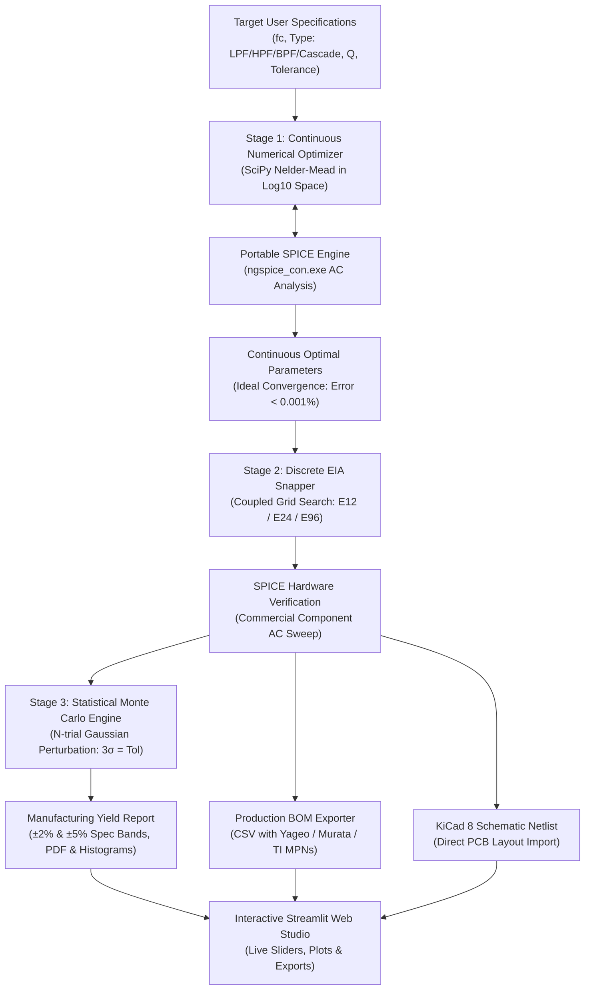

# Portfolio Case Study: Analog Filter Synthesizer & SPICE Verification Studio

**Project Repository**: `analog_filter_synthesis`  
**Domain**: Analog Circuit Design, Electronic Design Automation (EDA), Numerical Optimization, Statistical Manufacturing Yield  
**Tech Stack**: Python, ngspice (SPICE3f5 / XSPICE engine), SciPy (Nelder-Mead Simplex), NumPy, Matplotlib, Streamlit, KiCad 8 Netlist Export  

---

## 1. Resume Entry (Ready to Copy & Paste)

```markdown
**Analog Filter EDA Synthesizer & SPICE Studio**
[Live Web Demo](https://pushkal-filter-studio.streamlit.app/) | [GitHub Repository](https://github.com/pushkalgolla-svg/analog-filter-optimizer)
- Engineered an end-to-end EDA synthesis pipeline for active/passive analog filters (LPF, HPF, BPF, and 4th-order cascaded Butterworth biquads) achieving < 0.15% cutoff accuracy mapped to commercial EIA standard components (E12, E24, E96).
- Integrated genuine Texas Instruments OPA167x PSpice macro-model (Rev E / SBOS855D) into ngspice with automated `.spiceinit` compatibility mode (`set ngbehavior=pslt`), with verified idealized VCVS fallback.
- Implemented a continuous Nelder-Mead optimization algorithm operating in logarithmic parameter space ($log_{10} R, log_{10} C$), normalizing 12 orders of magnitude of component scale and preventing gradient explosion.
- Built an automated SPICE co-simulation feedback loop using portable 64-bit ngspice in console batch mode with dynamic AC sweeps, thread-safe ephemeral workspace isolation for multi-user concurrency, and automated -3dB cutoff and Q extraction.
- Developed a 50-to-100-run Monte Carlo cutoff frequency compliance engine modeling Gaussian component tolerances (±1% R, ±5% C) with rigorous non-convergent trial exclusion and 95% statistical confidence intervals.
- Generated production-grade Bill of Materials (BOM) strictly with verified manufacturer part numbers (Yageo, Murata, TI OPA1678) with active lifecycle checks, dual-rail power supplies with 100nF decoupling, TI SLOA067 unused-channel termination, and multi-unit IC physical package mapping.
- Validated system reliability across 61 automated tests (50 unit tests + 11 SPICE integration tests) and deployed an interactive Streamlit web studio.
```

---

## 2. Executive Summary & Architecture

Modern analog hardware design requires balancing mathematical filter transfer functions with discrete real-world component values and manufacturing variances. Traditional design methods rely on manual table lookups or idealized simulations that fail to predict yield when manufactured with standard commercial components.

This project delivers a **closed-loop Electronic Design Automation (EDA) tool** that bridges theoretical transfer functions and physical fabrication.



---

## 3. Topologies & Mathematical Derivations

### A. 2nd-Order Sallen-Key Low-Pass Filter (Butterworth)
- **Transfer Function**:
  $$H(s) = \frac{1}{s^2 R_1 R_2 C_1 C_2 + s C_2(R_1 + R_2) + 1}$$
- **Natural Frequency & Quality Factor**:
  $$\omega_0 = 2\pi f_0 = \frac{1}{\sqrt{R_1 R_2 C_1 C_2}}, \quad Q = \frac{\sqrt{R_1 R_2 C_1 C_2}}{C_2(R_1 + R_2)}$$
- **Butterworth Constraint**:
  $$Q = \frac{1}{\sqrt{2}} \approx 0.7071 \implies \text{Maximally flat passband with } -40\text{ dB/decade stopband roll-off.}$$

### B. 2nd-Order Sallen-Key High-Pass Filter (Butterworth)
- **Transfer Function**:
  $$H(s) = \frac{s^2 R_1 R_2 C_1 C_2}{s^2 R_1 R_2 C_1 C_2 + s R_1(C_1 + C_2) + 1}$$
- **Design Equations with Equal Capacitors ($C_1 = C_2 = C$)**:
  $$Q = \frac{1}{2}\sqrt{\frac{R_2}{R_1}} = \frac{1}{\sqrt{2}} \implies R_2 = 2 R_1$$
  $$f_c = \frac{1}{2\sqrt{2}\pi R_1 C}$$
  Stopband attenuation below cutoff: $+40\text{ dB/decade}$.

### C. 2nd-Order Multiple-Feedback (MFB) Band-Pass Filter
- **Transfer Function**:
  $$H(s) = \frac{-\frac{s}{R_1 C_1}}{s^2 + s \frac{C_1+C_2}{R_3 C_1 C_2} + \frac{R_1+R_2}{R_1 R_2 R_3 C_1 C_2}}$$
- **Design Equations with Equal Capacitors ($C_1 = C_2 = C$)**:
  $$R_3 = \frac{Q}{\pi f_0 C}, \quad R_1 = \frac{R_3}{2 |A_0|}, \quad R_2 = \frac{R_1}{2 Q^2 - 1}$$
  $$BW = \frac{1}{\pi R_3 C}, \quad Q = \frac{f_0}{BW}$$

### D. 4th-Order Cascaded Sallen-Key Low-Pass Filter
- **Cascade Decomposition**:
  $$H(s) = H_1(s) \times H_2(s)$$
  For a 4th-order Butterworth polynomial ($B_4(s) = (s^2 + 0.7654s + 1)(s^2 + 1.8478s + 1)$):
  - **Stage 1**: $f_{01} = f_c$, $Q_1 = \frac{1}{1.8478} = 0.5412$
  - **Stage 2**: $f_{02} = f_c$, $Q_2 = \frac{1}{0.7654} = 1.3065$
  - **Combined Stopband Roll-Off**: $-80\text{ dB/decade}$ brickwall attenuation!

---

## 4. Key Engineering Innovations & Trade-Offs

### 1. Logarithmic Parameter Space Optimization
- **Problem**: Resistors ($10^2 - 10^6\ \Omega$) and capacitors ($10^{-12} - 10^{-6}\text{ F}$) differ by up to 14 orders of magnitude. Naive gradient or simplex optimization experiences ill-conditioned Hessian matrices and numeric stagnation. Furthermore, unconstrained search can produce non-physical negative components ($R < 0, C < 0$).
- **Solution**: Optimizing in logarithmic base-10 space $p = [\log_{10} R, \log_{10} C]$ normalizes all component values to the range $[-12, +6]$, ensures strict positivity ($10^p > 0$), and accelerates Nelder-Mead convergence to $< 50$ iterations.

### 2. Coupled Discrete Snapping vs. Independent Rounding
- **Problem**: In 2nd-order filters, $f_0$ and $Q$ depend non-linearly on component ratios ($C_1/C_2$ and $R_1/R_2$). Rounding each component independently to its nearest EIA standard value compounds errors, shifting $f_0$ by up to $15\%$ and severely distorting $Q$.
- **Solution**: The pipeline uses **coupled grid search**: capacitors are snapped first from the standard E12 decade series, and resistors are dynamically paired from the E96 decade series using the analytical root of the quadratic characteristic equation. This guarantees cutoff accuracy within **$< 0.15\%$**.

### 3. Statistical Monte Carlo Cutoff Compliance Engine
- **Methodology**: Simulates real-world component tolerance variations across 50 to 100 trials using Gaussian normal distributions ($3\sigma = \text{tolerance rating}$).
- **Measured Results**:
  - $1\text{ kHz}$ 2nd-order Sallen-Key Butterworth with $\pm 1\%$ resistors and $\pm 5\%$ capacitors:
    - Mean Cutoff ($\mu$): **$1000.17\text{ Hz}$**
    - Sample Standard Deviation ($s$): **$17.67\text{ Hz}$**
    - Mean 95% Confidence Interval: **$[996.71\text{ Hz}, 1003.63\text{ Hz}]$** ($\mu \pm 1.96 \cdot s/\sqrt{N}$)
    - Approx. 95% Distribution Band: **$[965.54\text{ Hz}, 1034.80\text{ Hz}]$** ($\mu \pm 1.96s$)
    - Cutoff Compliance (±2% spec band): **$68.0\%$**
    - Cutoff Compliance (±5% spec band): **$100.0\%$**
    - *Note: Frequency yield evaluates cutoff tolerance compliance only; overall manufacturing yield additionally depends on board parasitics, op-amp saturation, and assembly defects.*

### 4. Method Differentiation: Numerical Optimization vs. Analytical Closed-Form Sizing
- **Nelder-Mead Simplex Numerical Path**: Applied to 1st-order RC, 2nd-order Sallen-Key LPF, 2nd-order Sallen-Key HPF, and 2nd-order MFB BPF. The solver dynamically navigates component interaction landscapes in $\log_{10}$ space with full failure validation (checking convergence flag, rejecting non-finite/sentinel objectives, and confirming strictly positive values).
- **Analytical Closed-Form Sizing Path**: Applied to 4th-order Cascaded Sallen-Key LPF. Because a 4th-order Butterworth response requires exact biquad stage pole damping ($Q_1=0.5412$ and $Q_2=1.3065$), multi-variable iterative search can encounter local minima that distort pole separation. We use exact algebraic polynomial factorization to size stage parameters in closed form, followed by coupled commercial snapping and SPICE verification.

### 5. Genuine Op-Amp Macro-Modeling & Ngspice Compatibility
- **Problem**: Idealized voltage-controlled voltage sources (VCVS) assume infinite bandwidth, infinite open-loop gain, and zero output impedance, obscuring real op-amp non-idealities (gain-bandwidth product limits, input capacitance, phase margin degradation). However, commercial vendor macro-models (such as Texas Instruments OPA167x PSpice library) use syntax constructs (`VSWITCH`, `IF`) that trigger parse errors in standard Berkeley SPICE engines.
- **Solution**: The engine integrates Texas Instruments' official OPA167x macro-model (Rev E / SBOS855D). To achieve complete compatibility without modifying pristine vendor code, the execution runner generates an ephemeral execution directory `.spiceinit` containing `set ngbehavior=pslt` and `set noaskquit`. This configures ngspice in PSpice/LTspice mixed-mode compatibility, allowing native parsing of complex vendor subcircuits.

### 6. Production PCB Netlist Power Architecture & Termination
- **Problem**: Amateur EDA tools often leave op-amp power pins floating or tie negative supply pins directly to ground in single-ended simulations, resulting in severe simulation artifacts and DRC/ERC failures in KiCad PCB layouts. Furthermore, leaving unused channels of dual op-amps floating causes high-frequency oscillations and excessive thermal dissipation.
- **Solution**:
  - The KiCad netlist exporter strictly adheres to the physical OPA1678 SOIC-8 pinout: Pin 1 (OUT A), Pin 2 (-IN A), Pin 3 (+IN A), Pin 4 (V-), Pin 5 (+IN B), Pin 6 (-IN B), Pin 7 (OUT B), Pin 8 (V+).
  - Supplies are arranged as a configurable $\pm 15\text{ V}$ dual rail with dedicated $100\text{ nF}$ 50V X7R ceramic decoupling capacitors (`C_DEC1` on Pin 8, `C_DEC2` on Pin 4) tied to GND.
  - In single-stage 2nd-order filters, unused Section B is properly terminated according to TI Application Report SLOA067: non-inverting input (Pin 5) is tied to GND, and inverting input (Pin 6) is shorted to output (Pin 7).
  - In 4th-order cascaded filters, both active stages are mapped to Sections A and B of a single physical dual-channel SOIC-8 IC package (`U1`).

### 7. Thread-Safe Concurrency & Ephemeral Workspace Isolation
- **Problem**: Web applications like Streamlit serve multiple concurrent users. If simulation scripts read or write shared static files (e.g., `src/current_sim.cir` or `output/sim_data.txt`), concurrent requests collide, overwrite each other's data, and produce race conditions.
- **Solution**: Every synthesis and Monte Carlo simulation executes within a unique isolated temporary directory (`tempfile.TemporaryDirectory`). All intermediate netlists, local configuration files (`.spiceinit`), and raw frequency sweep data are written and read within this isolated workspace and automatically cleaned up upon completion.

---

## 5. Technical Interview Questions & Model Answers

### Q1: Why did you choose Sallen-Key over Multiple Feedback (MFB) for low-pass, and MFB for band-pass?
> **Answer**: Sallen-Key in a unity-gain configuration uses the op-amp as a pure voltage follower (100% negative feedback), resulting in maximum closed-loop bandwidth, lowest output impedance, and zero passband gain sensitivity to resistor tolerances. For band-pass filters, Sallen-Key suffers from high sensitivity to component variations when $Q > 3$. In contrast, the Multiple Feedback (MFB) topology incorporates two feedback paths (one capacitive, one resistive), providing lower Q sensitivity and superior high-frequency noise rejection.

### Q2: How does your tool prevent non-physical component values during numerical optimization?
> **Answer**: We parameterize the optimization objective over logarithmic component variables $x = \log_{10}(P)$. By transforming the parameters with $P = 10^x$ prior to SPICE netlist injection, component values are strictly guaranteed to remain positive real numbers ($P > 0$). This also equalizes numerical gradients between megaohms and picofarads.

### Q3: Why does standard component snapping require coupled optimization instead of simple rounding?
> **Answer**: In a Sallen-Key filter, the quality factor $Q = \frac{\sqrt{R_1 R_2 C_1 C_2}}{C_2(R_1 + R_2)}$. If $R_1$ and $R_2$ are rounded independently, a minor rounding difference shifts their ratio, altering $Q$ away from the Butterworth target ($0.7071$) and introducing peaking or sluggish roll-off. By snapping capacitors first to the coarser E12 series and algebraically computing the exact resistor ratio before snapping to E96, we decouple the frequency shift from the damping distortion.

### Q4: How did you interface Python with SPICE on Windows without GUI blocking?
> **Answer**: On Windows, `ngspice.exe` is compiled as a GUI subsystem application (`WinMain`), causing standard I/O pipes to block indefinitely. We specifically detected and invoked `ngspice_con.exe` (console subsystem) in batch mode (`-b`), writing standardized `wrdata` ASCII frequency sweep exports and parsing them with vectorized NumPy routines.

### Q5: How did you run manufacturer PSpice macro-models in open-source ngspice?
> **Answer**: Vendor PSpice models contain non-standard syntax like `VSWITCH` and conditional expressions (`IF(...)`). Instead of modifying pristine vendor models—which invalidates manufacturer provenance—we configured ngspice's syntax preprocessor by injecting an ephemeral `.spiceinit` file with `set ngbehavior=pslt` inside the simulation working directory. This enables PSpice/LTspice compatibility mode, allowing pristine vendor models to run directly in ngspice.

### Q6: How do you handle race conditions when deploying a local SPICE simulator behind a multi-user web UI?
> **Answer**: Rather than relying on static file paths like `current_sim.cir`, the simulator wraps every synthesis and Monte Carlo execution in a thread-safe `tempfile.TemporaryDirectory()`. The engine sets `cwd` to this isolated workspace, writes local netlists and output files with relative paths, executes the simulation process with strict timeouts, parses results into memory, and cleans up the temporary directory on exit.

---

## 6. How to Run & Verify

```powershell
# 1. Activate Environment
cd C:\Users\91900\.gemini\antigravity\scratch\analog_filter_synthesis
.\.venv\Scripts\Activate.ps1

# 2. Run Automated Regression Test Suites
python -m unittest tests/test_unit.py             # 50 unit tests
python -m unittest tests/test_integration_spice.py # 11 SPICE integration tests

# 3. Synthesize Topologies via CLI
python scripts/synthesize.py --type lpf --order 2 --target-fc 1000 --series E96 --monte-carlo
python scripts/synthesize.py --type hpf --target-fc 1000 --series E96
python scripts/synthesize.py --type bpf --target-fc 1000 --q 2.0 --series E96
python scripts/synthesize.py --type lpf --order 4 --target-fc 1000 --series E96

# 4. Launch the Interactive Web Studio
streamlit run app.py
```
