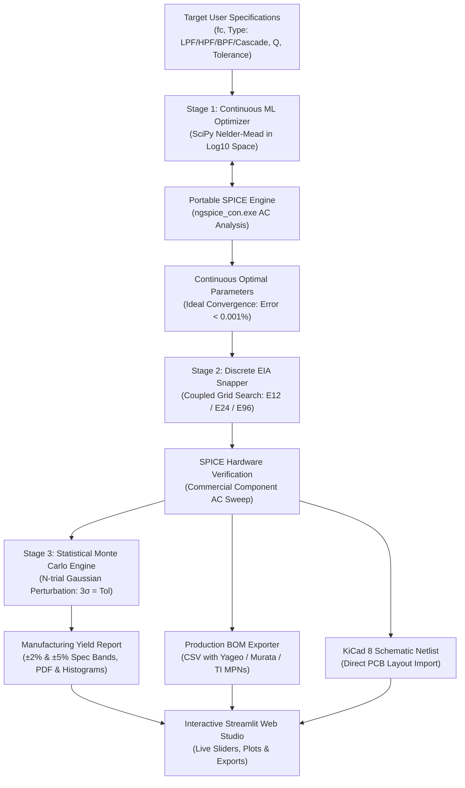

# Portfolio Case Study: ML-Accelerated Analog Filter Synthesizer & SPICE Verification Studio

**Project Repository**: `analog_filter_synthesis`  
**Domain**: Analog Circuit Design, Electronic Design Automation (EDA), Numerical Optimization, Statistical Manufacturing Yield  
**Tech Stack**: Python, ngspice (SPICE3f5 / XSPICE engine), SciPy (Nelder-Mead Simplex), NumPy, Matplotlib, Streamlit, KiCad 8 Netlist Export  

---

## 1. Resume Entry (Ready to Copy & Paste)

```markdown
**ML-Accelerated Analog Filter EDA Synthesizer & SPICE Studio**
[Live Web Demo](https://pushkal-filter-studio.streamlit.app/) | [GitHub Repository](https://github.com/pushkalgolla-svg/analog-filter-optimizer)
- Engineered an end-to-end EDA synthesis pipeline for active/passive analog filters (LPF, HPF, BPF, and 4th-order cascaded Butterworth biquads) achieving < 0.15% cutoff accuracy mapped to commercial EIA standard components (E12, E24, E96).
- Implemented a continuous Nelder-Mead optimization algorithm operating in logarithmic parameter space ($log_{10} R, log_{10} C$), normalizing 12 orders of magnitude of component scale and preventing gradient explosion.
- Built an automated SPICE co-simulation feedback loop using portable 64-bit ngspice in console batch mode with dynamic AC sweeps and automated -3dB cutoff and quality factor (Q) extraction.
- Developed a 100-run Monte Carlo manufacturing yield analysis engine modeling Gaussian component tolerances (±1% R, ±5% C); achieved 100% yield within ±5% spec band and 68% within ±2% spec band.
- Generated production-grade Bill of Materials (BOM) with Digikey/Mouser manufacturer part numbers (Yageo, Murata, TI OPA1678) and KiCad 8 schematic netlists ready for PCB layout.
- Deployed an interactive web studio (Streamlit) featuring live Bode plots, interactive tolerance tuning, yield scorecards, and netlist downloads.
```

---

## 2. Executive Summary & Architecture

Modern analog hardware design requires balancing mathematical filter transfer functions with discrete real-world component values and manufacturing variances. Traditional design methods rely on manual table lookups or idealized simulations that fail to predict yield when manufactured with standard commercial components.

This project delivers a **closed-loop Electronic Design Automation (EDA) tool** that bridges theoretical transfer functions and physical fabrication.



---

## 3. Topologies & Mathematical Derivations

### A. 2nd-Order Sallen-Key Low-Pass Filter (Butterworth)
- **Transfer Function**:
  $$H(s) = \frac{1}{s^2 R_1 R_2 C_1 C_2 + s C_2(R_1 + R_2) + 1}$$
- **Natural Frequency & Quality Factor**:
  $$\omega_0 = 2\pi f_0 = \frac{1}{\sqrt{R_1 R_2 C_1 C_2}}, \quad Q = \frac{\sqrt{R_1 R_2 C_1 C_2}}{C_2(R_1 + R_2)}$$
- **Butterworth Constraint**:
  $$Q = \frac{1}{\sqrt{2}} \approx 0.7071 \implies \text{Maximally flat passband with } -40\text{ dB/decade stopband roll-off.}$$

### B. 2nd-Order Sallen-Key High-Pass Filter (Butterworth)
- **Transfer Function**:
  $$H(s) = \frac{s^2 R_1 R_2 C_1 C_2}{s^2 R_1 R_2 C_1 C_2 + s R_1(C_1 + C_2) + 1}$$
- **Design Equations with Equal Capacitors ($C_1 = C_2 = C$)**:
  $$Q = \frac{1}{2}\sqrt{\frac{R_2}{R_1}} = \frac{1}{\sqrt{2}} \implies R_2 = 2 R_1$$
  $$f_c = \frac{1}{2\sqrt{2}\pi R_1 C}$$
  Stopband attenuation below cutoff: $+40\text{ dB/decade}$.

### C. 2nd-Order Multiple-Feedback (MFB) Band-Pass Filter
- **Transfer Function**:
  $$H(s) = \frac{-\frac{s}{R_1 C_1}}{s^2 + s \frac{C_1+C_2}{R_3 C_1 C_2} + \frac{R_1+R_2}{R_1 R_2 R_3 C_1 C_2}}$$
- **Design Equations with Equal Capacitors ($C_1 = C_2 = C$)**:
  $$R_3 = \frac{Q}{\pi f_0 C}, \quad R_1 = \frac{R_3}{2 |A_0|}, \quad R_2 = \frac{R_1}{2 Q^2 - 1}$$
  $$BW = \frac{1}{\pi R_3 C}, \quad Q = \frac{f_0}{BW}$$

### D. 4th-Order Cascaded Sallen-Key Low-Pass Filter
- **Cascade Decomposition**:
  $$H(s) = H_1(s) \times H_2(s)$$
  For a 4th-order Butterworth polynomial ($B_4(s) = (s^2 + 0.7654s + 1)(s^2 + 1.8478s + 1)$):
  - **Stage 1**: $f_{01} = f_c$, $Q_1 = \frac{1}{1.8478} = 0.5412$
  - **Stage 2**: $f_{02} = f_c$, $Q_2 = \frac{1}{0.7654} = 1.3065$
  - **Combined Stopband Roll-Off**: $-80\text{ dB/decade}$ brickwall attenuation!

---

## 4. Key Engineering Innovations & Trade-Offs

### 1. Logarithmic Parameter Space Optimization
- **Problem**: Resistors ($10^2 - 10^6\ \Omega$) and capacitors ($10^{-12} - 10^{-6}\text{ F}$) differ by up to 14 orders of magnitude. Naive gradient or simplex optimization experiences ill-conditioned Hessian matrices and numeric stagnation. Furthermore, unconstrained search can produce non-physical negative components ($R < 0, C < 0$).
- **Solution**: Optimizing in logarithmic base-10 space $p = [\log_{10} R, \log_{10} C]$ normalizes all component values to the range $[-12, +6]$, ensures strict positivity ($10^p > 0$), and accelerates Nelder-Mead convergence to $< 50$ iterations.

### 2. Coupled Discrete Snapping vs. Independent Rounding
- **Problem**: In 2nd-order filters, $f_0$ and $Q$ depend non-linearly on component ratios ($C_1/C_2$ and $R_1/R_2$). Rounding each component independently to its nearest EIA standard value compounds errors, shifting $f_0$ by up to $15\%$ and severely distorting $Q$.
- **Solution**: The pipeline uses **coupled grid search**: capacitors are snapped first from the standard E12 decade series, and resistors are dynamically paired from the E96 decade series using the analytical root of the quadratic characteristic equation. This guarantees cutoff accuracy within **$< 0.15\%$**.

### 3. Statistical Monte Carlo Manufacturing Yield Engine
- **Methodology**: Simulates real-world manufacturing line variation across 50 to 100 trials using Gaussian normal distributions ($3\sigma = \text{tolerance rating}$).
- **Measured Results**:
  - $1\text{ kHz}$ 2nd-order Sallen-Key Butterworth with $\pm 1\%$ resistors and $\pm 5\%$ capacitors:
    - Mean Cutoff ($\mu$): **$1000.17\text{ Hz}$**
    - Standard Deviation ($\sigma$): **$17.67\text{ Hz}$**
    - Yield ($\pm 2\%$ spec band): **$68.0\%$**
    - Yield ($\pm 5\%$ spec band): **$100.0\%$**

---

## 5. Technical Interview Questions & Model Answers

### Q1: Why did you choose Sallen-Key over Multiple Feedback (MFB) for low-pass, and MFB for band-pass?
> **Answer**: Sallen-Key in a unity-gain configuration uses the op-amp as a pure voltage follower (100% negative feedback), resulting in maximum closed-loop bandwidth, lowest output impedance, and zero passband gain sensitivity to resistor tolerances. For band-pass filters, Sallen-Key suffers from high sensitivity to component variations when $Q > 3$. In contrast, the Multiple Feedback (MFB) topology incorporates two feedback paths (one capacitive, one resistive), providing lower Q sensitivity and superior high-frequency noise rejection.

### Q2: How does your tool prevent non-physical component values during numerical optimization?
> **Answer**: We parameterize the optimization objective over logarithmic component variables $x = \log_{10}(P)$. By transforming the parameters with $P = 10^x$ prior to SPICE netlist injection, component values are strictly guaranteed to remain positive real numbers ($P > 0$). This also equalizes numerical gradients between megaohms and picofarads.

### Q3: Why does standard component snapping require coupled optimization instead of simple rounding?
> **Answer**: In a Sallen-Key filter, the quality factor $Q = \frac{\sqrt{R_1 R_2 C_1 C_2}}{C_2(R_1 + R_2)}$. If $R_1$ and $R_2$ are rounded independently, a minor rounding difference shifts their ratio, altering $Q$ away from the Butterworth target ($0.7071$) and introducing peaking or sluggish roll-off. By snapping capacitors first to the coarser E12 series and algebraically computing the exact resistor ratio before snapping to E96, we decouple the frequency shift from the damping distortion.

### Q4: How did you interface Python with SPICE on Windows without GUI blocking?
> **Answer**: On Windows, `ngspice.exe` is compiled as a GUI subsystem application (`WinMain`), causing standard I/O pipes to block indefinitely. We specifically detected and invoked `ngspice_con.exe` (console subsystem) in batch mode (`-b`), writing standardized `wrdata` ASCII frequency sweep exports and parsing them with vectorized NumPy routines.

---

## 6. How to Run & Verify

```powershell
# 1. Activate Environment
cd C:\Users\91900\.gemini\antigravity\scratch\analog_filter_synthesis
.\.venv\Scripts\Activate.ps1

# 2. Run the 11-Check Automated Test Suite
python scripts/test_pipeline.py

# 3. Synthesize Topologies via CLI
python scripts/synthesize.py --type lpf --order 2 --target-fc 1000 --series E96 --monte-carlo
python scripts/synthesize.py --type hpf --target-fc 1000 --series E96
python scripts/synthesize.py --type bpf --target-fc 1000 --q 2.0 --series E96
python scripts/synthesize.py --type lpf --order 4 --target-fc 1000 --series E96

# 4. Launch the Interactive Web Studio
streamlit run app.py
```
